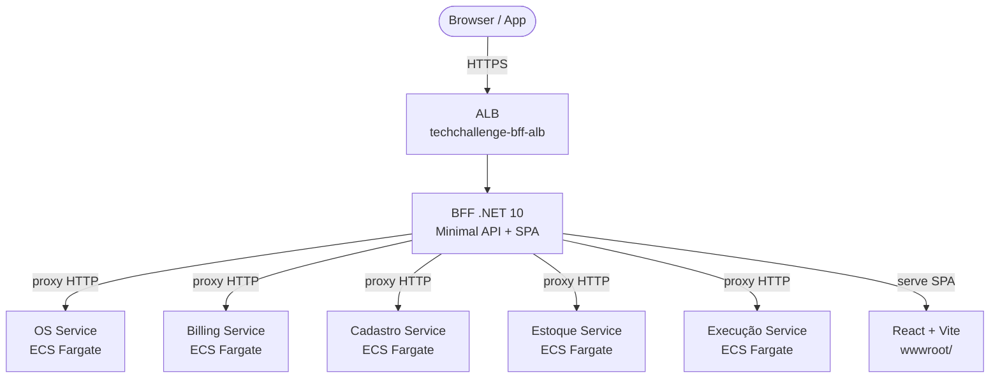

# TechChallenge.bff — Backend For Frontend

> Fase 4 — FIAP SOAT · Arquitetura de Microsserviços com Saga Pattern

BFF responsável por **unificar o acesso a todos os microsserviços** e servir o frontend React. É o único ponto de entrada para o cliente, validando JWT e roteando as requisições para os serviços downstream. Inclui o frontend React completo da oficina TechChallenger.

---

## 🔗 Repositórios do TechChallenger

| Serviço | Repositório | Responsabilidade |
|---------|-------------|------------------|
| OS Service | [TechChallenge.OS](https://github.com/TechChallenge01/TechChallenge.OS) | Ciclo de vida das Ordens de Serviço |
| Billing Service | [TechChallenge.Billing](https://github.com/TechChallenge01/TechChallenge.Billing) | Orçamentos e pagamentos (Mercado Pago) |
| Cadastro Service | [TechChallenge.Cadastro](https://github.com/TechChallenge01/TechChallenge.Cadastro) | Clientes, produtos e categorias |
| Estoque Service | [TechChallenge.Estoque](https://github.com/TechChallenge01/TechChallenge.Estoque) | Reserva e liberação de peças |
| Execução Service | [TechChallenge.Execucao](https://github.com/TechChallenge01/TechChallenge.Execucao) | Fila de execução e reparos |
| **BFF** ← *este* | [TechChallenge.bff](https://github.com/TechChallenge01/TechChallenge.bff) | Gateway + Frontend React |

---

## 🏗️ Arquitetura deste repositório



**Stack:**

| Componente | Tecnologia |
|------------|------------|
| Backend (proxy) | .NET 10 Minimal API · `IHttpClientFactory` |
| Frontend | React 18 + Vite + TypeScript + Tailwind CSS |
| Build | Multi-stage Docker (Node 20 → .NET 10) |
| Deploy | AWS ECS Fargate · ALB `techchallenge-bff-alb` |

**URL de produção:** `http://techchallenge-bff-alb-1127953352.us-east-1.elb.amazonaws.com`

> O BFF é **stateless** — não possui banco de dados próprio e não interage com o RabbitMQ. Comunicação assíncrona (Saga) é responsabilidade de cada microsserviço.

---

## 🎯 Objetivo da Fase 4

- Prover ponto único de entrada para o cliente (SPA + API)
- Abstrair a complexidade de múltiplos microsserviços do frontend
- Validar autenticação JWT centralmente antes de rotear para os serviços
- Pipeline CI/CD independente com build multi-stage e deploy no ECS Fargate
- Monitoramento e observabilidade com **CloudWatch** e **Datadog**

---

## ⚙️ Pré-requisitos

**Execução local:**
- [.NET 10 SDK](https://dotnet.microsoft.com/download/dotnet/10.0)
- [Node.js 20+](https://nodejs.org/)
- [Docker Desktop](https://www.docker.com/products/docker-desktop/)
- Os demais microsserviços rodando localmente ou no ECS

**Infraestrutura AWS:**
- AWS CLI configurado (`aws configure`)
- Terraform ≥ 1.9
- Acesso ao cluster ECS `techchallenge` em `us-east-1`

---

## 🚀 Como Executar

### Local — Backend (proxy)

```bash
git clone https://github.com/TechChallenge01/TechChallenge.bff.git
cd TechChallenge.bff
dotnet run --project src/BFF
```

### Local — Frontend (hot reload)

```bash
cd frontend
npm install
npm run dev
```

Acesse: `http://localhost:5173` (Vite dev server)

### Com Docker Compose (backend + frontend embutido)

```bash
docker compose up -d
```

---

## 🔐 Variáveis de Ambiente

| Variável | Descrição | Exemplo |
|----------|-----------|---------|
| `Jwt__Key` | Chave JWT para validação — **deve ser igual em todos os serviços** | — |
| `Jwt__Issuer` | Issuer JWT | `TechChallenger` |
| `Jwt__Audience` | Audience JWT | `TechChallenger` |
| `Services__Auth` | URL do Cadastro Service (auth) | `http://cadastro-alb/` |
| `Services__OS` | URL do OS Service | `http://os-alb/` |
| `Services__Billing` | URL do Billing Service | `http://billing-alb/` |
| `Services__Cadastro` | URL do Cadastro Service | `http://cadastro-alb/` |
| `Services__Estoque` | URL do Estoque Service | `http://estoque-alb/` |
| `Services__Execucao` | URL do Execução Service | `http://execucao-alb/` |

Em produção, as URLs dos serviços são injetadas pelo Terraform (ALB DNS names via variáveis de ambiente ECS).

---

## 📡 Endpoints do BFF

O BFF roteia todas as requisições com prefixo `/api/` para o serviço correspondente, validando o JWT previamente.

| Método | Rota BFF | Serviço | Autenticação |
|--------|----------|---------|--------------|
| `POST` | `/api/auth/login` | Cadastro | — |
| `POST` | `/api/clientes` | Cadastro | Bearer |
| `GET` | `/api/clientes/{id}` | Cadastro | Bearer |
| `GET` | `/api/categorias` | Cadastro | Bearer |
| `POST` | `/api/categorias` | Cadastro | Bearer |
| `GET` | `/api/produtos` | Cadastro | Bearer |
| `POST` | `/api/produtos` | Cadastro | Bearer |
| `POST` | `/api/ordens-servico` | OS | Bearer |
| `GET` | `/api/ordens-servico` | OS | Bearer |
| `GET` | `/api/ordens-servico/{id}` | OS | Bearer |
| `POST` | `/api/ordens-servico/{id}/iniciar-diagnostico` | OS | Bearer |
| `POST` | `/api/ordens-servico/{id}/registrar-diagnostico` | OS | Bearer |
| `POST` | `/api/orcamentos/{id}/aprovar` | Billing | Bearer |
| `POST` | `/api/orcamentos/{id}/rejeitar` | Billing | Bearer |
| `GET` | `/api/orcamentos` | Billing | Bearer |
| `GET` | `/api/estoque/{produtoId}` | Estoque | Bearer |
| `POST` | `/api/estoque` | Estoque | Bearer |
| `GET` | `/api/execucoes/{id}` | Execução | Bearer |
| `POST` | `/api/execucoes/{id}/finalizar` | Execução | Bearer |

---

## 🏭 Infraestrutura

**Deploy:** AWS ECS Fargate · cluster `techchallenge` · `us-east-1`  
**ALB:** `techchallenge-bff-alb-1127953352.us-east-1.elb.amazonaws.com`

Infraestrutura como código em `infra/` (Terraform):

| Arquivo | Recurso |
|---------|---------|
| `ecs.tf` | ECS Service + Task Definition |
| `ecr.tf` | Repositório ECR para a imagem Docker |
| `alb.tf` | Application Load Balancer (público) |
| `cloudwatch.tf` | Log groups `/ecs/bff-service` |
| `data-sources.tf` | Data sources (VPC, subnets, cluster ECS) |

---

## 📦 Kubernetes

Manifestos em `k8s/`:

| Arquivo | Recurso |
|---------|---------|
| `deployment.yaml` | 2 réplicas, liveness/readiness probes |
| `service.yaml` | ClusterIP porta 80 |
| `hpa.yaml` | Auto-scaling 2–5 pods (70% CPU) |
| `ingress.yaml` | Ingress com SSL termination |

---

## 🔁 CI/CD

| Workflow | Trigger | Jobs |
|----------|---------|------|
| `deploy.yml` | push `main` (src/ ou frontend/) | Build multi-stage → Push ECR → Deploy ECS |
| `quality.yml` | push/PR `main` | Frontend build check + Backend SonarCloud |
| `infra.yml` | push `main` (infra/) | Terraform plan/apply |
| `k8s-deploy.yml` | manual (`workflow_dispatch`) | Deploy EKS |

O deploy constrói imagem única com **build multi-stage**: Node 20 compila o frontend React (gerando assets em `wwwroot/`), e .NET 10 serve tanto o backend quanto o frontend estático.

---

## 🧪 Testes

```bash
# Backend
dotnet test tests/

# Frontend
cd frontend
npm run build  # valida tipagem e bundling
```

- **Quality CI:** SonarCloud para backend + build check para frontend

---

## 📚 Documentação da API

Scalar UI disponível em:

- **Local:** `http://localhost:5000/scalar`
- **Produção:** `http://techchallenge-bff-alb-1127953352.us-east-1.elb.amazonaws.com/scalar`

---

## 📬 Collection Postman

A collection completa do TechChallenger está disponível neste repositório:

📂 [`docs/TechChallenger-Postman-Collection.json`](docs/TechChallenger-Postman-Collection.json)

**Conteúdo da collection (33 requests):**

| Pasta | Requests |
|-------|----------|
| 1. Auth | Login por CPF |
| 2. Ordem de Serviço | Abrir, listar, buscar, diagnosticar, finalizar, cancelar |
| 3. Billing | Gerar orçamento, aprovar, rejeitar, pagamentos |
| 4. Cadastro | Clientes, produtos, categorias |
| 5. Estoque | Consultar, adicionar, ajustar |
| 6. Execução | Buscar, marcar pronto, finalizar |
| 7. BFF (via proxy) | Fluxo completo via gateway |

Importar no Postman: **File → Import → selecionar o arquivo JSON**

---

## 🗂️ Estrutura do Projeto

```
TechChallenge.bff/
├── src/
│   └── BFF/             # .NET 10 Minimal API (proxy + JWT validation)
├── frontend/            # React + Vite + TypeScript + Tailwind
│   ├── src/
│   └── package.json
├── docs/
│   ├── TechChallenger-Postman-Collection.json
│   └── index.html
├── k8s/                 # Manifestos Kubernetes
├── infra/               # Terraform (ECS, ECR, ALB, CloudWatch)
└── .github/workflows/   # CI/CD pipelines
```
